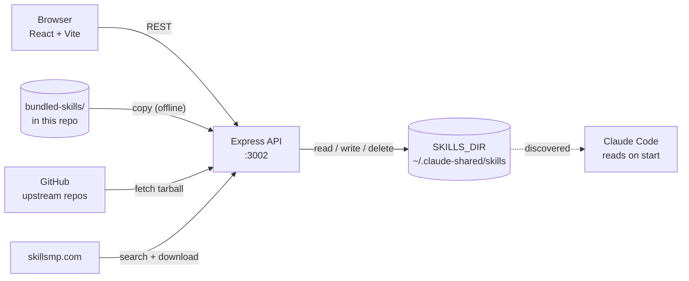

# Claude Skills Manager

A local web UI for creating, browsing, and installing [Claude Code](https://claude.com/claude-code) skills — and for sharing a set of them with friends.

It ships with **Hitman's Skill Set**: ten ready-to-use skills you can install in one click.

[](LICENSE) [](https://nodejs.org)

---

## Get the skills (start here)

If someone sent you this repo, this is the whole thing:

```bash
git clone https://github.com/DulajDil/claude-skills-manager.git
cd claude-skills-manager
npm run install:all
npm run dev
```

Then:

1. Open **<http://localhost:5173>**
2. Click **Starter Set**
3. Hit **Install all**
4. **Restart Claude Code**

That's it. The skills now work as `/commit`, `/debug`, `/explain`, and so on — or Claude picks them automatically when your request matches one.

> **Don't want to run the app?** Copy the folders straight in:
> ```bash
> for d in bundled-skills/*/; do
>   [ -f "$d/SKILL.md" ] && cp -R "$d" ~/.claude/skills/
> done
> ```

---

## What's in the set

| Skill | What it does |
|-------|--------------|
| `commit` | Conventional commit message read off the staged diff |
| `commit-and-push` | Format, build-check, commit, then push — with approval gates |
| `generate-commit-message` | Strict Conventional Commits v1.0.0 output, commitlint-valid, with attribution footers |
| `code-reviewer` | Reviews a diff for correctness, security, and maintainability, ranked by severity |
| `code-simplifier` | Cleans up recently changed code for clarity — without changing behaviour |
| `debug` | Reproduce, locate, hypothesise, verify, fix — no guessing |
| `explain` | Explains code: what, how, why, and the gotchas |
| `pr-description` | Drafts a PR title, summary, and test plan from branch commits |
| `test` | Thorough unit tests following the project's existing framework |
| `ui-ux-pro-max` <sup>↗</sup> | Design intelligence: UI styles, colour palettes, font pairings, UX guidelines |

<sup>↗</sup> Fetched from [its upstream repo](https://github.com/nextlevelbuilder/ui-ux-pro-max-skill) on install rather than copied into this one, so you always get the current version. **Needs a network connection** — the other nine work offline.

Three commit skills look redundant but aren't: `commit` is the quick one, `commit-and-push` runs the full format → build → push workflow, and `generate-commit-message` is the strict commitlint-compliant generator. Use whichever fits.

📖 **[`bundled-skills/README.md`](bundled-skills/README.md)** — what each skill does in practice, the phrases that trigger it, and how to add your own.

---

## Table of Contents

- [Get the skills](#get-the-skills-start-here)
- [What's in the set](#whats-in-the-set)
- [About](#about)
- [Features](#features)
- [Tech Stack](#tech-stack)
- [Architecture](#architecture)
- [Development](#development)
- [Configuration](#configuration)
- [How skills work](#how-skills-work)
- [Security](#security)
- [Reference](#reference) — project structure, API, deployment
- [Contributing](#contributing)
- [License](#license)
- [Author](#author)

---

## About

Claude Code reads skills from folders on disk. That's simple, but it means managing them is a filesystem chore, and *sharing* them means zipping folders around.

This app fixes both:

- **Manage** — create, edit, and delete skills from a browser instead of hand-editing YAML frontmatter.
- **Share** — the skills live in [`bundled-skills/`](bundled-skills/) inside this repo, so cloning it *is* getting the skills. One click installs them into your own library.

It's a local tool. It runs on your machine, writes to your skills directory, and has no accounts or cloud component.

---

## Features

| | |
|---|---|
| **My Skills** | Full create/read/update/delete for your skill library |
| **Starter Set** | One-click install of the skills bundled in this repo — works offline |
| **Agents** | Compose agents from your skills and export them as `CLAUDE.md` |
| **Usage** | Token and cost breakdown read from your local Claude Code logs |
| **Marketplace** | Search [skillsmp.com](https://skillsmp.com) (1.3M+ community skills) and install directly |
| **Dark / light mode** | Persisted to `localStorage` |
| **Responsive** | Works on phone and tablet over your LAN |

---

## Tech Stack

**Frontend** — React 18, Vite, TypeScript, Tailwind CSS, shadcn/ui, React Router, Sonner
**Backend** — Node.js 20+, Express 4, TypeScript, fs-extra, gray-matter
**Packaging** — Docker (multi-stage), Railway config included

---

## Architecture

One Express API serves both the REST endpoints and the built React app. Skills are plain files on disk — there is no database.



The Starter Set has two install paths:

| Path | Used for | Needs network |
|------|----------|---------------|
| **Vendored** | The nine skills stored in `bundled-skills/` | No |
| **External** | Skills declared with a `source` in `manifest.json` — fetched from GitHub at install time | Yes |

External entries exist so large, actively-maintained skills don't have to be copied in and go stale. Only repos named in `bundled-skills/manifest.json` are ever fetched — the browser sends a skill id, never a URL.

---

## Development

**Prerequisites:** Node.js 20+ and npm.

```bash
npm run install:all   # install root, server, and client deps
npm run dev           # start both dev servers
```

| | |
|---|---|
| Frontend (hot reload) | <http://localhost:5173> |
| API | <http://localhost:3002> |

Other commands:

```bash
npm run build   # type-check and build client + server
npm start       # serve the built app + API on one port (3002)
npm run usage   # token/cost report in the terminal
```

---

## Configuration

Optional — the defaults work. To change anything:

```bash
cp .env.example server/.env
```

| Variable | Default | What it does |
|----------|---------|--------------|
| `PORT` | `3002` | Port for the Express API |
| `SKILLS_DIR` | `~/.claude-shared/skills` | Where skills are read from and written to. Point it at `~/.claude/skills` to skip symlinks — see [How skills work](#how-skills-work) |
| `AGENTS_DIR` | `~/.claude/agents` | Where agents are stored |
| `SKILLSMP_API_KEY` | *(none)* | Raises the marketplace limit from 50 to 500 searches/day. [Free key](https://skillsmp.com) |

`dotenv` does not expand `$HOME`, so use absolute paths.

---

## How skills work

Every skill is a folder containing a `SKILL.md`:

```
<SKILLS_DIR>/
└── commit/
    └── SKILL.md        ← Claude Code reads this
```

```markdown
---
name: my-skill
description: Use this skill when the user asks to... (trigger conditions)
version: 1.0.0
---

# My Skill

## Instructions
...
```

The `description` is the important part — it's what Claude matches your request against when deciding whether to use the skill. Write it as trigger conditions, not as a summary.

**Where Claude looks:** `~/.claude/skills` (all projects) and `.claude/skills` (one project). If your `SKILLS_DIR` is somewhere else — like the default `~/.claude-shared/skills` — symlink it in:

```bash
ln -s ~/.claude-shared/skills/commit ~/.claude/skills/commit
```

Or just set `SKILLS_DIR=~/.claude/skills` and skip the symlinks. **Restart Claude Code after installing** so it rescans.

---

## Security

> [!IMPORTANT]
> **Keep this on localhost.** The server reads, writes, and deletes files in your skills directory by design, and it has **no authentication**. Anyone who can reach the port can create and delete skills on that machine.

Run it on `localhost`, or on a LAN you trust. Don't put it behind a public tunnel or a public Railway URL without adding authentication first.

Skill and agent ids are validated as strict slugs (`^[a-z0-9][a-z0-9-]*$`) and checked for directory containment in [`server/src/lib/safePath.ts`](server/src/lib/safePath.ts), so a request can't escape the skills directory. That limits the blast radius — it is not a substitute for access control.

**Reaching it from your phone** (same Wi-Fi) — find your local IP and open `http://<your-ip>:3002`:

```bash
ipconfig getifaddr en0
```

---

## Reference

<details>
<summary><strong>Project structure</strong></summary>

```
claude-skills-manager/
├── bundled-skills/             # Hitman's Skill Set — ships with the repo
│   ├── README.md               # what each skill does + how to add your own
│   ├── manifest.json           # which skills appear on the Starter Set page
│   └── <skill-name>/SKILL.md
├── server/                     # Express API (TypeScript)
│   └── src/
│       ├── lib/safePath.ts     # slug validation + directory containment
│       ├── routes/
│       │   ├── skills.ts       # CRUD for local skills
│       │   ├── bundled.ts      # starter set listing + install
│       │   ├── agents.ts       # agent CRUD
│       │   ├── usage.ts        # local token/cost stats
│       │   └── marketplace.ts  # skillsmp.com proxy + download
│       └── index.ts
├── client/                     # React + Vite + shadcn/ui
│   └── src/
│       ├── pages/              # Skills, Starter, Marketplace, Usage, Agents
│       ├── components/
│       └── lib/
├── scripts/usage.mjs           # CLI token/cost reporting
├── Dockerfile
└── .env.example
```

</details>

<details>
<summary><strong>API reference</strong></summary>

### Local skills

| Method | Path | Description |
|--------|------|-------------|
| `GET` | `/api/skills` | List all skills |
| `GET` | `/api/skills/:id` | Get one skill |
| `POST` | `/api/skills` | Create a skill |
| `PUT` | `/api/skills/:id` | Update a skill |
| `DELETE` | `/api/skills/:id` | Delete a skill |

Ids must match `^[a-z0-9][a-z0-9-]*$`; anything else returns `400`.

### Starter set

| Method | Path | Description |
|--------|------|-------------|
| `GET` | `/api/bundled` | List bundled skills and whether each is installed |
| `POST` | `/api/bundled/install` | Install one (`{ id }`) or all (`{ all: true }`); `{ overwrite: true }` replaces |

`install` returns `{ installed, skipped }`. Check `skipped` for entries that already existed or whose upstream download failed.

### Marketplace

| Method | Path | Description |
|--------|------|-------------|
| `GET` | `/api/marketplace/search?q=...` | Search skillsmp.com |
| `POST` | `/api/marketplace/download` | Download a skill from GitHub into your library |

</details>

<details>
<summary><strong>Deployment (Docker / Railway)</strong></summary>

> [!WARNING]
> A public URL puts an unauthenticated file-writing API on the internet. Add authentication first, and never point `SKILLS_DIR` at a real home directory. See [Security](#security).

**Docker**

```bash
docker build -t claude-skills .
docker run -p 3002:3002 \
  -e SKILLS_DIR=/skills \
  -v ~/.claude/skills:/skills \
  claude-skills
```

**Railway** — push to GitHub, create a project from the repo, and Railway builds the `Dockerfile` automatically. Add a volume mounted at `/data`, then set `SKILLS_DIR=/data/skills` so skills survive deploys. `PORT` is set by Railway.

</details>

---

## Contributing

To add a skill to the shared set: drop a folder with a `SKILL.md` into `bundled-skills/`, add its id to `bundled-skills/manifest.json`, and refresh the Starter Set page. Full instructions — including how to add an external, fetched-on-install skill — are in [`bundled-skills/README.md`](bundled-skills/README.md).

Commits follow [Conventional Commits](https://www.conventionalcommits.org/). There's a skill for that in the box.

---

## License

[MIT](LICENSE) — do what you like with it: use it, change it, ship it in something commercial, keep your changes private. Just keep the copyright notice around, and understand that if it breaks something, that's on you.

The skills written for this repo are MIT too; use and adapt them freely. `ui-ux-pro-max` is MIT © [NextLevelBuilder](https://github.com/nextlevelbuilder/ui-ux-pro-max-skill) and is fetched from its own repository, so its licence travels with it.

---

## Acknowledgements

- [NextLevelBuilder](https://github.com/nextlevelbuilder/ui-ux-pro-max-skill) for `ui-ux-pro-max`
- [skillsmp.com](https://skillsmp.com) for the community skill index
- [shadcn/ui](https://ui.shadcn.com) for the component primitives

---

## Author

**Dulaj Dilrukshan** ([@DulajDil](https://github.com/DulajDil))
